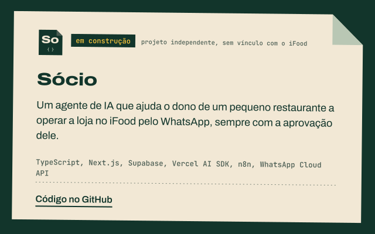
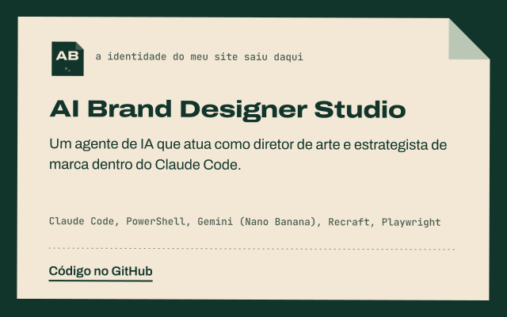
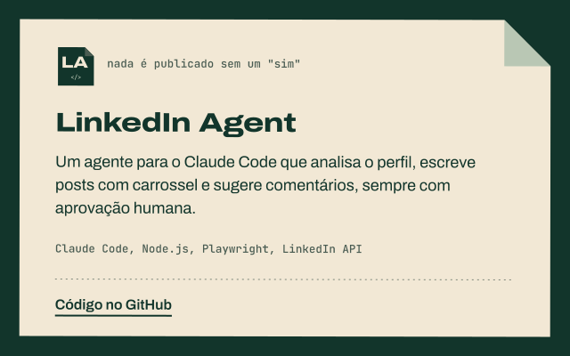
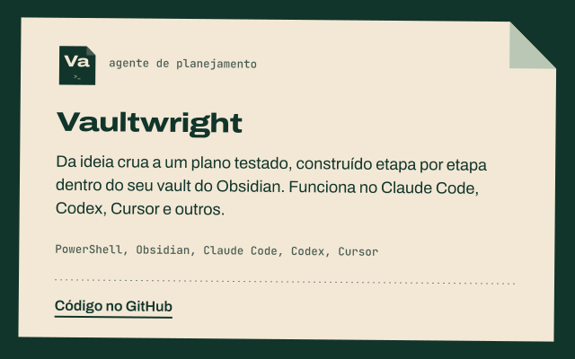
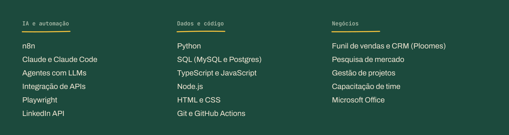

<p align="center">
  <a href="https://www.felip.cloud"></a>
</p>

<p align="center">
  <a href="https://www.felip.cloud"></a>&nbsp;
  <a href="https://www.linkedin.com/in/felipepaschoinireis"></a>&nbsp;
  <a href="mailto:fepaschoini@gmail.com"></a>&nbsp;
  <a href="https://wa.me/5535988989758"></a>
</p>

## Engenharia com visão de negócio

Sou o **Felipe Paschoini Reis**, estudante de **Engenharia Eletrônica e de Telecomunicações na UFU**, e trabalho com **IA aplicada e automação de processos**. Antes de programar fluxos, eu vendia: coordenei o time de negócios da **CONSELT** (empresa júnior) e fundei um e-commerce próprio. Por isso olho para automação pelo lado de quem usa: qual tarefa manual dá para tirar das mãos de alguém e quanto tempo isso devolve.

- Hoje construo agentes de IA e fluxos com **n8n, Python e LLMs**, sempre com aprovação humana antes de qualquer ação, e estudo **SQL, TypeScript e dados**.
- Procuro **estágio em IA e automação de dados, inovação ou gestão de projetos**.

```ts
const felipe = {
  formacao: "Eng. Eletrônica e de Telecomunicações @ UFU",
  foco: ["IA aplicada", "Automação de processos", "Dados"],
  stack: ["n8n", "Python", "SQL", "TypeScript", "JavaScript"],
  bagagem: "Vendas, CRM e gestão de time",
};
```

## O que estou construindo

Os projetos abertos ficam aqui, com o processo à mostra. Cada repositório público ganha um ícone e um card automaticamente.

<!-- projetos:inicio (gerado por .github/brand/gerar.js, não edite à mão) -->
<p align="center">
  <a href="https://github.com/1felip/socio"></a>
  <a href="https://github.com/1felip/ai-brand-designer-studio"></a>
</p>

<p align="center">
  <a href="https://github.com/1felip/linkedin-agent-claude-code"></a>
  <a href="https://github.com/1felip/vaultwright"></a>
</p>

| | Repositório | O que faz |
| :-: | :-- | :-- |
|  | **[Sócio](https://github.com/1felip/socio)** | Um agente de IA que ajuda o dono de um pequeno restaurante a operar a loja no iFood pelo WhatsApp, sempre com a aprovação dele. |
|  | **[AI Brand Designer Studio](https://github.com/1felip/ai-brand-designer-studio)** | Um agente de IA que atua como diretor de arte e estrategista de marca dentro do Claude Code. |
|  | **[LinkedIn Agent](https://github.com/1felip/linkedin-agent-claude-code)** | Um agente para o Claude Code que analisa o perfil, escreve posts com carrossel e sugere comentários, sempre com aprovação humana. |
|  | **[Vaultwright](https://github.com/1felip/vaultwright)** | Da ideia crua a um plano testado, construído etapa por etapa dentro do seu vault do Obsidian. Funciona no Claude Code, Codex, Cursor e outros. |
<!-- projetos:fim -->

## Do balcão de vendas ao fluxo que roda sozinho

<p align="center">
  
</p>

## Ferramentas

<p align="center">
  
</p>

## Contribuições

<p align="center">
  
</p>

<p align="center">
  
</p>

---

<p align="center">
  <strong>Tem um processo manual que dá para automatizar?</strong><br/>
  Conte qual tarefa toma tempo do seu time: <a href="https://www.linkedin.com/in/felipepaschoinireis">LinkedIn</a> · <a href="mailto:fepaschoini@gmail.com">e-mail</a> · <a href="https://www.felip.cloud">felip.cloud</a>
</p>

<p align="center">
  
  <br/><sub><code>Construído em público, anotado no caminho.</code></sub>
</p>
