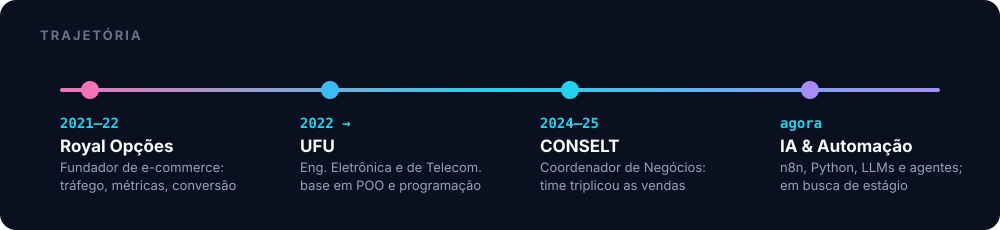
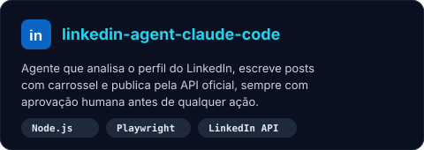
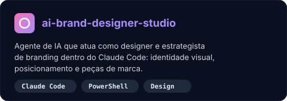
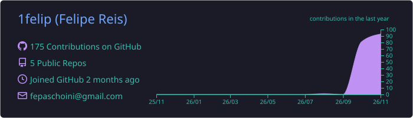
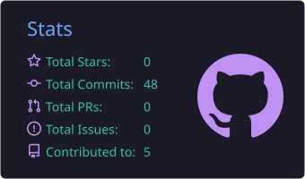
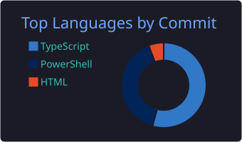

<p align="center">
  
</p>

<p align="center">
  <a href="https://www.linkedin.com/in/felipepaschoinireis"></a>&nbsp;
  <a href="mailto:fepaschoini@gmail.com"></a>&nbsp;
  <a href="https://wa.me/5535988989758"></a>
</p>

<p align="center">
  
  
  
</p>

---

## Sobre mim

Sou estudante de **Engenharia Eletrônica e de Telecomunicações na UFU** e trabalho com **Inteligência Artificial aplicada e automação de processos**. Antes de programar fluxos, eu vendia: coordenei o time de negócios da **CONSELT** (empresa júnior) e fundei um e-commerce próprio. Por isso olho para automação pelo lado de quem usa: qual tarefa manual dá para tirar das mãos de alguém e quanto tempo isso devolve.

- Hoje estou construindo agentes de IA e fluxos com **n8n, Python e LLMs**, e estudando **SQL, TypeScript e dados**.
- Procuro **estágio em IA e automação de dados, inovação ou gestão de projetos**.


```ts
const felipe = {
  formacao: "Eng. Eletrônica e de Telecomunicações @ UFU",
  foco: ["IA aplicada", "Automação de processos", "Dados"],
  stack: ["n8n", "Python", "SQL", "TypeScript", "JavaScript"],
  bagagem: "Vendas, CRM e gestão de time",
};
```

<p align="center">
  
</p>

## Linguagens e ferramentas

<p align="center">
  
  <br/><br/>
  
</p>

<p align="center">
  
  
  
  
  
  
  
</p>

## Competências

| IA e automação | Dados e código | Negócios e gestão |
| :-- | :-- | :-- |
| Agentes de IA com LLMs | Python e POO | Gestão de projetos |
| Fluxos no n8n | SQL | Funil de vendas e CRM |
| Integração de APIs | TypeScript e JavaScript | Pesquisa de mercado e precificação |
| Automação com navegador (Playwright) | Versionamento com Git | Liderança de time e capacitação |

## Projetos em destaque

<p align="center">
  <a href="https://github.com/1felip/linkedin-agent-claude-code"></a>
  <a href="https://github.com/1felip/ai-brand-designer-studio"></a>
</p>

- **[linkedin-agent-claude-code](https://github.com/1felip/linkedin-agent-claude-code)**: agente para o Claude Code que analisa o perfil do LinkedIn, escreve posts com carrossel de imagens e publica pela API oficial, sempre com aprovação humana antes de qualquer ação.
- **[ai-brand-designer-studio](https://github.com/1felip/ai-brand-designer-studio)**: agente de IA que atua como designer e estrategista de branding dentro do Claude Code.

## Contribuições no GitHub

<p align="center">
  
</p>

<p align="center">
  
  
</p>

<p align="center">
  
</p>

<p align="center">
  <picture>
    <source media="(prefers-color-scheme: dark)" srcset="https://raw.githubusercontent.com/1felip/1felip/output/github-snake-dark.svg"/>
    <source media="(prefers-color-scheme: light)" srcset="https://raw.githubusercontent.com/1felip/1felip/output/github-snake.svg"/>
    
  </picture>
</p>

---

<p align="center">
  Quer conversar sobre IA, automação ou um processo que dá para automatizar? <a href="https://www.linkedin.com/in/felipepaschoinireis">Me chama no LinkedIn</a>.
</p>
